# WMS 물류관리시스템

[](https://github.com/mikoman80-miko/Logistics-Project/actions/workflows/ci.yml)

Django(백엔드)와 Vue(프런트엔드)로 만든 창고 관리 시스템입니다. 발주·입고부터 재고, 주문·출고, 택배 연동, 반품까지 한 흐름으로 다루고, 현장 작업자는 바코드 스캔만으로 작업합니다.

## 한눈에 보기

| | |
| --- | --- |
| **해결하려는 문제** | 엑셀·종이로 하던 입출고와 재고 관리에서 생기는 수량 불일치, 잘못된 출고, 추적 불가 |
| **핵심 기능** | 시리얼·수량 겸용 재고, 위치별 재고와 이동, 스캔 입고·출고·집품, 묶음배송·부분 출고, 반품, 스캔·순환 재고 조사, 발주 제안, 일일 마감, 변경 이력 |
| **연동** | 가상 택배사 서버(운송장 발급, 집하 요청, 서명된 웹훅), 슬랙·디스코드 알림 |
| **기술** | Django 6 · DRF · JWT · MariaDB / Vue 3 · Pinia · Tailwind v4 · Vite / Playwright · GitHub Actions · pm2 · waitress |
| **품질** | 단위 테스트 169개, Playwright 화면 테스트 32개, Ruff·ESLint(경고 0), pre-commit, CI |

자세한 데이터 구조(ERD)와 설계 결정은 [docs/DESIGN.md](docs/DESIGN.md), 폴더 구조는 [docs/ARCHITECTURE.md](docs/ARCHITECTURE.md)를 봅니다.

## 빠르게 체험하기

설치(아래 "처음 설치") 후 시연용 데이터를 넣고 서버를 켜면 모든 메뉴를 바로 눌러 볼 수 있습니다.

```powershell
myenv\Scripts\python manage.py seed_demo   # 개발 DB 전용. 발주→입고→주문→출고→반품을 실제 API로 처리해 만든 데이터
npm run start                              # http://localhost:5173
```

시연 영상(1분 22초)과 제출용 포트폴리오 PDF는 [portfolio/](portfolio/) 폴더에 있습니다. ([WMS_시연영상.mp4](portfolio/WMS_시연영상.mp4), [WMS_포트폴리오.pdf](portfolio/WMS_포트폴리오.pdf))

시연 계정(공개용 데모 값)은 관리자 `manager01`, 현장작업자 `worker01`~`worker05`이고 비밀번호는 `Demo-wms-2026!`입니다.

## 화면

시연 데이터(`seed_demo`)로 캡처한 화면입니다.

### 관리 화면

| 오늘 할 일 | 재고 현황 |
| --- | --- |
| 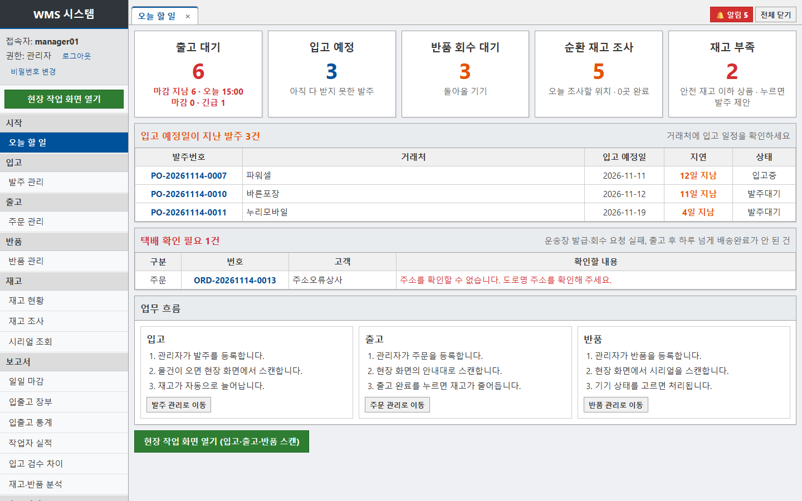 | 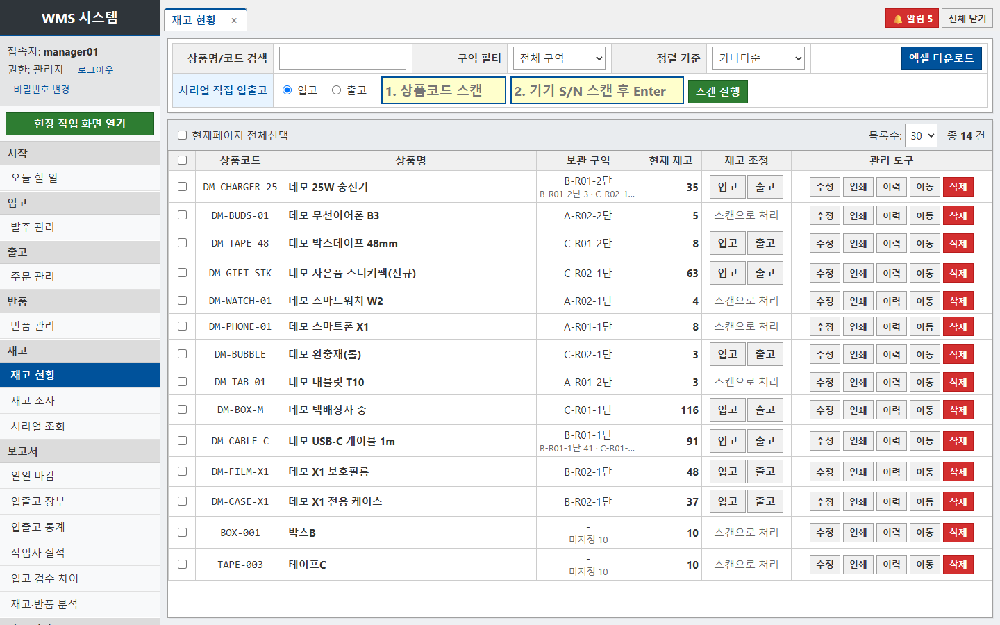 |
| **주문 관리** | **발주 관리** |
| 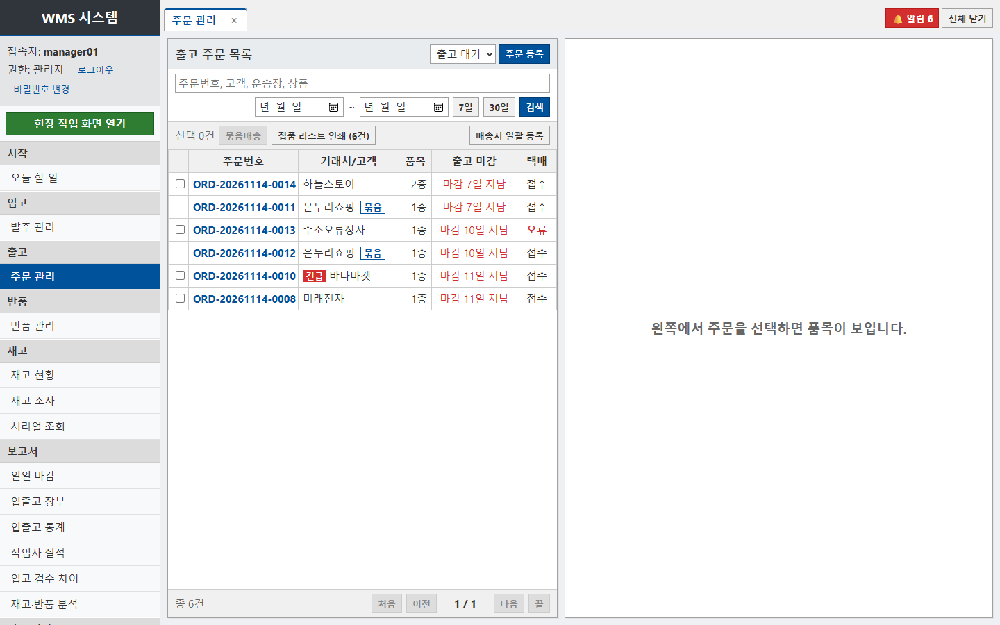 | 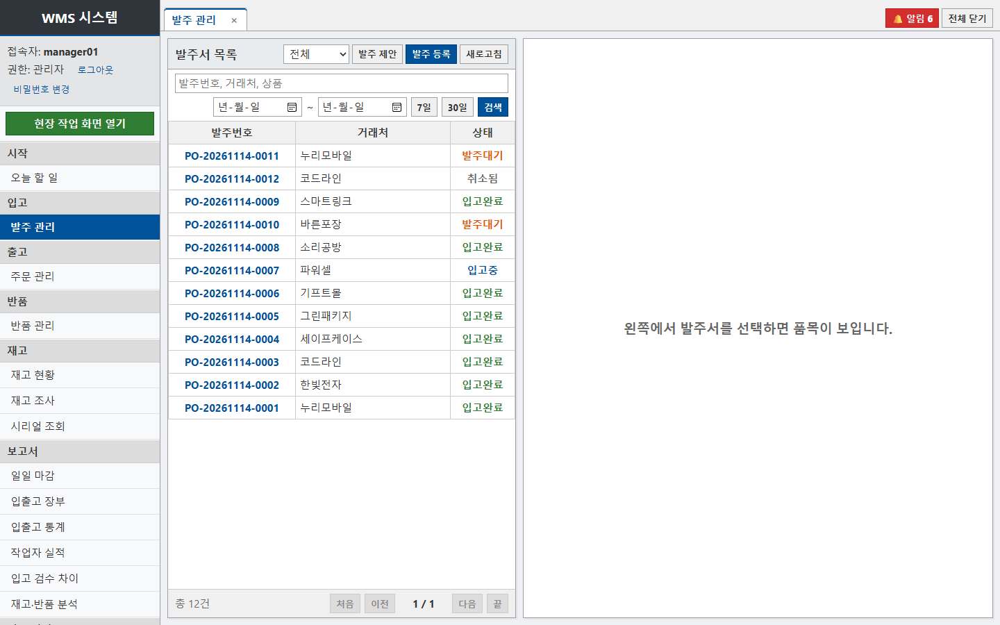 |
| **입출고 통계** | **재고·반품 분석** |
| 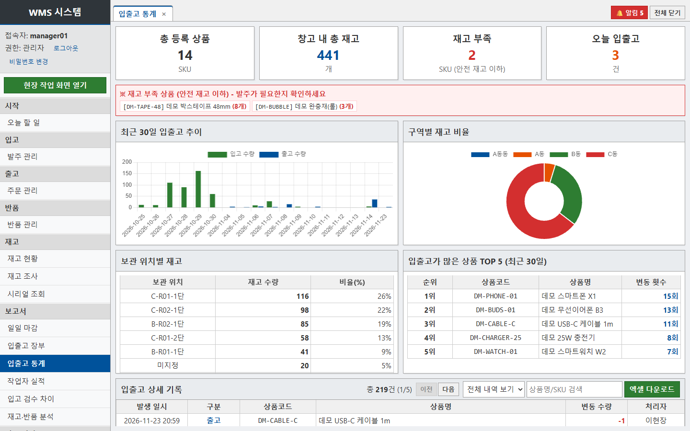 | 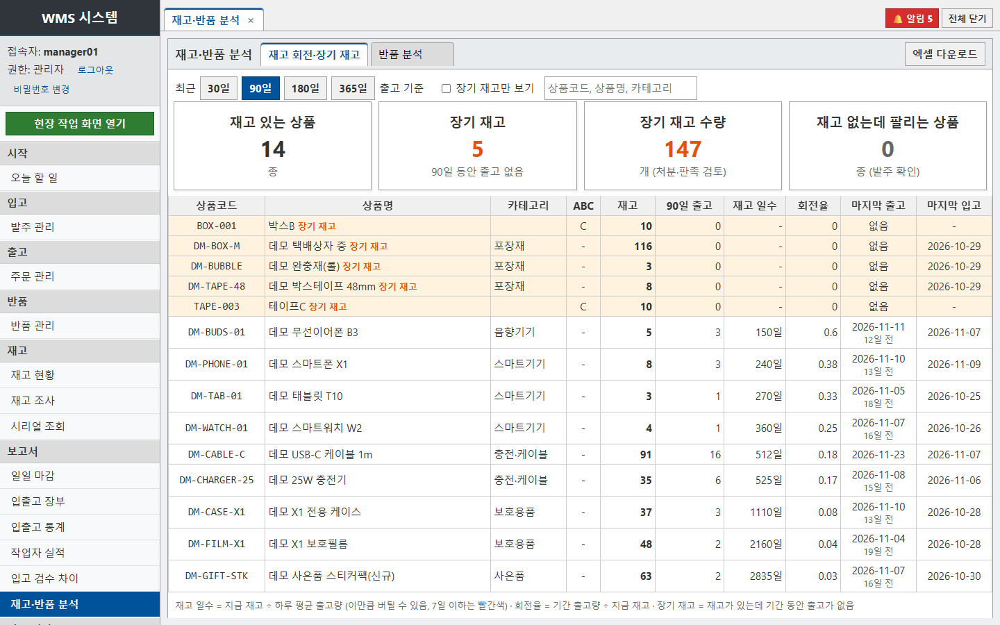 |
| **일일 마감** | **작업자 실적** |
| 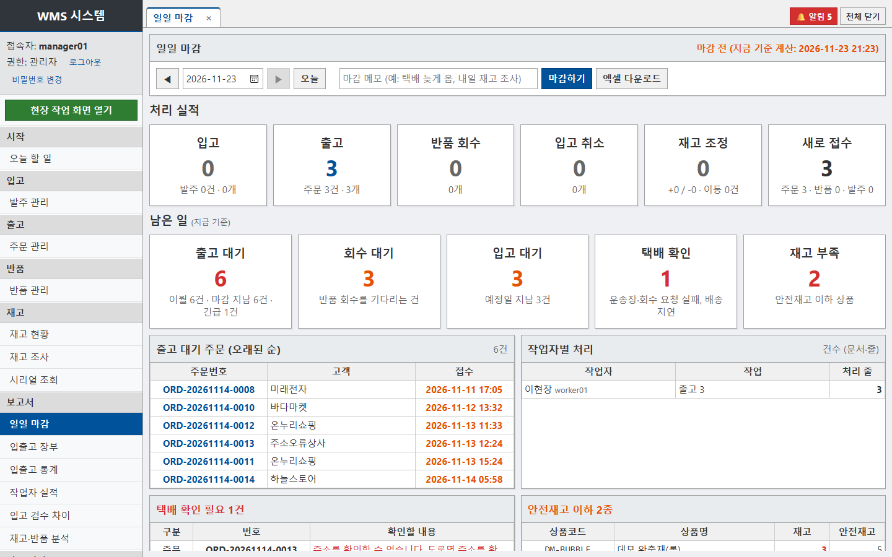 | 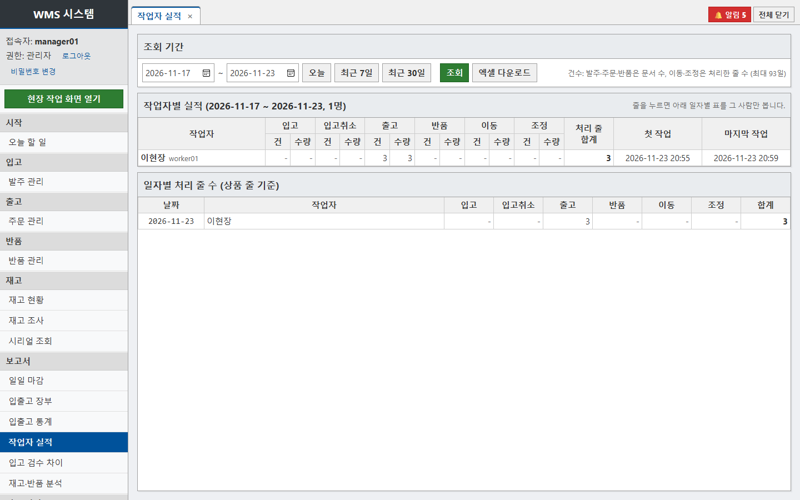 |

### 현장 화면 (스캔 작업, 큰 글씨)

| 현장 홈 | 출고 | 입고 |
| --- | --- | --- |
| 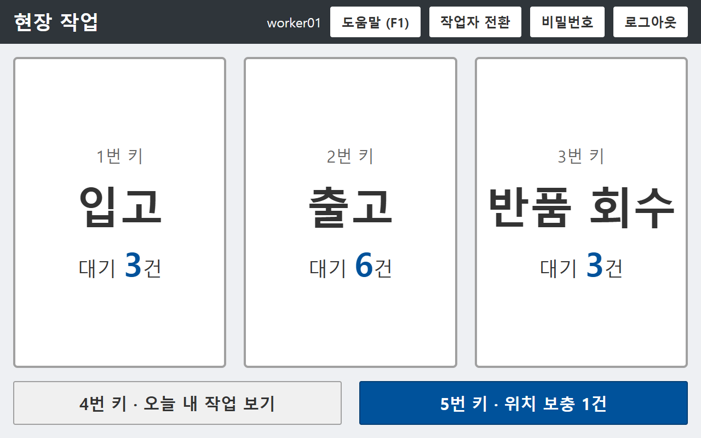 | 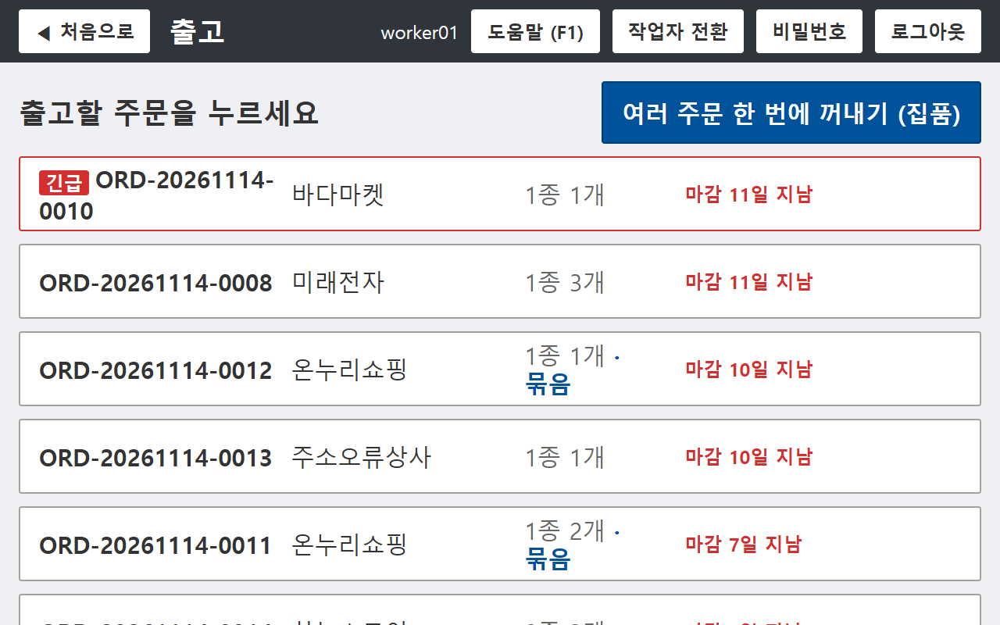 | 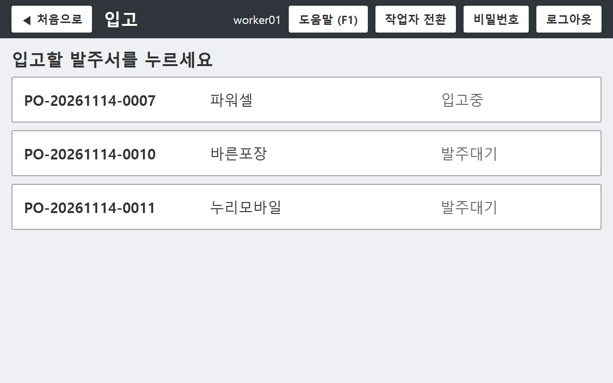 |

### 가상 택배사 송장 콘솔

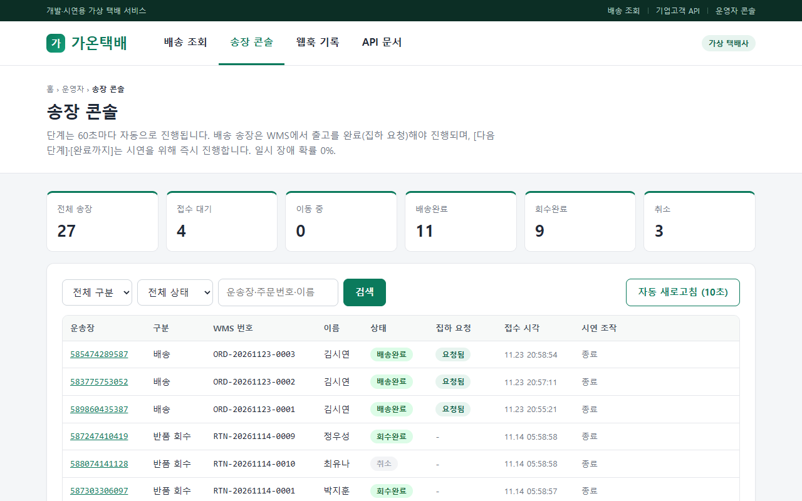

## 처음 설치

필요한 프로그램: Python 3.14, Node.js 24, MariaDB

```powershell
# 백엔드 (프로젝트 루트)
python -m venv myenv
myenv\Scripts\python -m pip install -r requirements.txt
copy .env.example .env    # 값을 채웁니다
myenv\Scripts\python manage.py migrate
myenv\Scripts\python manage.py createsuperuser

# 프런트엔드와 pm2
npm ci
cd wms-frontend
npm ci
```

`.env`의 `DJANGO_SECRET_KEY`는 아래 명령으로 만듭니다.

```powershell
myenv\Scripts\python -c "import secrets; print(secrets.token_urlsafe(64))"
```

## 실행

Django(8000), 화면(5173), 가상 택배사(8100)를 pm2로 한 번에 실행합니다. 모두 프로젝트 루트에서 입력합니다.

```powershell
npm run start      # 세 서버 실행
npm run restart    # 세 서버 재시작
npm run status     # 상태 확인
npm run logs       # 로그 보기 (Ctrl+C로 빠져나옵니다)
npm run stop       # 멈춤 (pm2 목록에는 남음)
npm run down       # 멈추고 pm2 목록에서도 지움
```

- 하나만 재시작할 때는 `npx pm2 restart django`처럼 이름(django, frontend, carrier)을 붙입니다.
- 파이썬 파일(config, inventory, mock_carrier)을 고치면 해당 서버가 자동으로 재시작됩니다. 화면은 Vite가 바로 반영합니다.
- 서버를 따로 띄우던 터미널이 있으면 먼저 닫아야 포트가 겹치지 않습니다.
- 실행할 서버 목록과 설정은 `ecosystem.config.js`에 있으므로 `pm2 save`는 하지 않아도 됩니다. PC를 다시 켠 뒤에는 `npm run start`를 한 번 입력합니다.
- 파이썬 서버는 `scripts/run-python.js`를 거쳐 실행합니다. Windows에서 빈 콘솔 창이 뜨지 않게 하기 위해서입니다.

브라우저에서 http://localhost:5173 으로 접속합니다.

## 운영 모드로 실행

현장에서 여러 사람이 쓸 때는 개발 서버 대신 운영 모드로 실행합니다. 화면을 빌드해 Django와 함께 운영용 서버(waitress) 한 개로 제공하므로 빠르고 안정적입니다.

```powershell
npm run prod:start     # 화면 빌드 + 정적 파일 모으기 + DB 구조 반영 후 운영 서버(8080) 실행
npm run prod:restart   # 코드를 바꾼 뒤 다시 빌드하고 재시작
npm run prod:stop      # 멈춤
npx pm2 logs wms       # 로그 보기
```

- 운영 서버를 띄운 PC에서는 http://localhost:8080, 현장 PC에서는 http://<운영 PC의 IP>:8080 으로 접속합니다. 시작할 때 로그에 접속 주소가 나옵니다.
- 운영 모드는 `.env`의 `DJANGO_DEBUG`와 관계없이 디버그를 끄고, 이 PC의 이름과 IP를 접속 허용 목록에 자동으로 넣습니다. 다른 이름(도메인)으로 접속하면 `DJANGO_ALLOWED_HOSTS`에 추가합니다.
- 다른 PC에서 접속하려면 운영 PC의 방화벽에서 8080 포트를 한 번 열어야 합니다. 관리자 PowerShell에서:
  `New-NetFirewallRule -DisplayName "WMS 8080" -Direction Inbound -Protocol TCP -LocalPort 8080 -Action Allow -Profile Private`
- 개발 서버(`npm run start`, 8000·5173)와 운영 서버(8080)는 포트가 달라 함께 띄워도 됩니다. 둘 다 같은 DB를 씁니다.
- 가상 택배사를 쓸 때는 개발 서버 묶음의 carrier도 켜 둡니다: `npx pm2 start ecosystem.config.js --only carrier`
- PC를 다시 켜면 `npm run prod:start`를 한 번 입력합니다.
- 동시 처리 수는 `WMS_THREADS`(기본 8), 포트는 `WMS_PORT`(기본 8080) 환경 변수로 바꿉니다.

## 오류 감시와 로그

- 서버 로그는 `logs` 폴더에 하루 단위로 남습니다. 개발 서버는 `dev.log`, 운영 서버는 `prod.log`이고, 오류만 모은 `*-error.log`도 따로 있습니다. 전체 로그는 30일, 오류 로그는 90일 보관합니다.
- `.env`에 `ALERT_WEBHOOK_URL`(슬랙·디스코드 웹훅)을 넣으면 다음을 바로 알립니다. 같은 오류는 `ALERT_REPEAT_MINUTES`(기본 10분)에 한 번만 보냅니다.
  - 처리하지 못한 서버 오류 (어느 화면 주소에서 어떤 오류인지)
  - 택배사 서버 연결이 `CARRIER_FAIL_ALERT`(기본 3)번 연속 실패했을 때와 다시 연결됐을 때
- 같은 알림(재고 부족, 재고 조정, 입고 지연, 일일 마감, 서버 오류, 택배 장애)은 웹훅 주소가 없어도 관리 화면 위쪽 [🔔 알림]에 남습니다. 열면 읽음으로 표시되고, 누르면 관련 화면으로 갑니다. 90일 지난 알림은 지워집니다.
- 서버 상태는 로그인 없이 http://<주소>/api/health/ 로 확인합니다. DB까지 연결되면 `"status": "ok"`가 나옵니다.

## 권한

- **관리자:** `is_staff`가 켜진 계정입니다. 로그인하면 "오늘 할 일" 화면이 열리고, 주문·발주·반품 등록과 기본 설정, 보고서를 사용합니다.
- **현장작업자:** 일반 계정입니다. 로그인하면 현장 작업 화면(`/work`)만 열리고, 스캔으로 입고·출고·반품 회수를 처리합니다.
- 계정은 http://127.0.0.1:8000/admin/ 에서 만듭니다.

## 시리얼 관리

- 상품마다 구분(상품, 구성품, 부자재, 사은품)과 시리얼 관리 여부를 정합니다. 기본값은 상품만 시리얼 관리입니다.
- 설정은 기본 설정 → 상품에서 언제든 바꿀 수 있습니다. 단, 진행 중인 주문이나 발주서에 포함된 상품은 끝난 뒤에 바꿉니다.
- 시리얼 관리 상품은 입출고할 때 시리얼을 1개씩 스캔합니다. 관리하지 않는 상품은 상품코드를 스캔하거나 수량을 입력합니다.
- 시리얼 없이 들어와 있던 재고는 그 수량 안에서, 상품코드를 스캔한 뒤 시리얼을 스캔하면 출고 때 등록됩니다.
- 잘못 입고한 품목은 현장 입고 화면이나 발주 관리에서 [입고 취소]로 되돌립니다. 시리얼 관리 상품은 시리얼 1개씩, 그 외는 수량으로 취소합니다.
- 재고 조사에서 시리얼 관리 상품의 수량은 재고보유 시리얼 수보다 적게 줄일 수 없습니다. 없어진 기기는 시리얼 조회에서 상태를 바꿉니다.
- 기본 설정 → 보관 위치에서 위치 라벨을 인쇄해 선반에 붙입니다. 현장 입고·출고 중에 위치 라벨을 스캔하면 지금 품목의 자리가 맞는지 확인합니다.
- 시리얼 조회에서 행을 누르면 그 기기의 입고, 출고 주문(운송장), 반품 이력을 시간순으로 봅니다.
- 바코드 스캐너는 키보드처럼 입력하므로 영문 입력 상태여야 합니다. 한글 상태로 스캔하면 화면이 안내합니다.

## 주문·배송 편의 기능

- 묶음배송: 주문 관리에서 받는 분과 배송지가 같은 출고대기 주문을 골라 [묶음배송]을 누르면 운송장 하나로 보냅니다. 같은 배송지 주문이 있으면 목록에 "묶음 가능"이 표시됩니다. 모두 출고해야 집하를 요청하며, [묶음 해제]로 되돌립니다.
- 배송지 일괄 등록: 주문 관리 → [배송지 일괄 등록]에서 양식을 내려받아 엑셀로 고친 뒤 올립니다. 바뀌는 내용을 먼저 보여주고, [저장]하면 운송장을 새로 발급합니다.
- 엑셀: 내려받기는 모두 xlsx이고, 올리기는 xlsx·xls·csv를 받습니다.
- 비밀번호 변경: 관리 화면 왼쪽 위 [비밀번호 변경], 현장 화면 위쪽 [비밀번호]에서 직접 바꿉니다.
- 현장 도움말: 현장 화면에서 F1 또는 위쪽 [도움말 (F1)]을 누르면 그 화면의 작업 순서와 자주 나는 오류의 해결 방법이 큰 글씨로 나옵니다. 내용은 `wms-frontend/src/utils/workHelp.js`에서 고칩니다.
- 현장 홈의 [오늘 내 작업](4번 키)에서 작업자가 오늘 처리한 입출고를 봅니다.
- 반품: 시리얼 기기는 시리얼로, 시리얼 없는 상품은 상품과 수량으로 등록합니다. 원래 주문을 고르면 그 주문에서 나간 수량까지만 반품하고 그 배송지에서 회수합니다. 현장에서는 상품 바코드를 스캔해 [재고로 되돌림] 또는 [폐기]를 고릅니다.
- 부분 출고: 재고가 모자라면 현장 출고 화면의 [있는 것만 출고]로 스캔한 만큼 먼저 보내고, 남은 수량은 같은 배송지의 새 주문으로 등록됩니다. (묶음배송 주문은 묶음 해제 후 가능)
- 스캔 재고 조사: 재고 조사 → [스캔 조사]에서 위치를 고르고 선반의 물건을 스캔한 뒤 [대조하기]를 누릅니다. 수량 상품은 스캔한 개수로 맞추고, 못 찾은 시리얼 기기는 "분실"로 처리할 수 있습니다.
- 발주 제안: 오늘 할 일의 재고 부족 카드나 발주 관리의 [발주 제안]에서, 안전 재고와 최근 30일 출고량으로 계산한 수량을 거래처별 발주서로 만듭니다. 조달 기간은 `.env`의 `REORDER_LEAD_DAYS`(기본 7일)입니다.
- 입고 예정일이 지난 발주는 오늘 할 일에 표시됩니다. 슬랙·디스코드 알림은 `myenv\Scripts\python manage.py notify_overdue`를 Windows 작업 스케줄러에 매일 아침 등록해 보냅니다.
- 사용자 관리: 기본 설정 → 사용자에서 계정 등록, 권한 변경, 비밀번호 초기화, 사용 중지를 합니다.
- 변경 이력: 기본 설정 → 변경 이력에서 상품·위치·거래처·카테고리·사용자를 누가 언제 무엇을 바꿨는지 봅니다. (재고 수량 변화는 입출고 장부에 남습니다)
- 위치별 재고: 한 상품을 여러 선반에 나눠 보관합니다. 재고 현황의 [이동]으로 위치 사이에 옮기고, 현장 입고 때 다른 선반 라벨을 스캔하면 그 선반에 넣습니다. 위치가 기록되지 않은 수량은 "위치 미지정"으로 보입니다.
- 사원증: 사용자 화면에서 현장작업자에게 [사원증 발급] 후 카드를 인쇄합니다. 로그인 화면에서 사원증을 스캔하면 바로 로그인되고, 현장 화면의 [작업자 전환]으로 다음 작업자로 바꿉니다. 잃어버리면 [사원증 재발급]으로 예전 것을 무효로 합니다.
- 집품 리스트 인쇄: 주문 관리에서 주문을 고르고(안 고르면 목록의 출고대기 전부) [집품 리스트 인쇄]를 누르면 위치 순서 목록과 주문별 나누기 표를 종이로 뽑습니다.
- 집품: 현장 출고 화면의 [여러 주문 한 번에 꺼내기]에서 주문 여러 건을 골라 위치 순서로 한 번에 꺼낸 뒤, 주문별로 나눠 출고 화면에서 스캔합니다.
- 출고 마감: `.env`의 `SHIP_CUTOFF_TIME`(기본 15:00) 전에 들어온 주문은 그날, 지나서 들어온 주문은 다음 출고일에 나가야 합니다. 토·일요일은 출고일에서 빼며, 주말에도 출고하면 `SHIP_ON_WEEKENDS=1`로 둡니다. 현장 출고 목록은 긴급 → 마감 빠른 순으로 정렬되고 남은 시간이 보입니다. 주문 관리에서 [긴급 지정]을 누르면 맨 위로 올라갑니다.
- 순환 재고 조사: 재고 조사 → 스캔 조사 위쪽의 [오늘의 순환 조사]에 오늘 조사할 위치가 나옵니다. 오래 조사하지 않은 곳, 입출고가 많은 곳이 먼저입니다. 조사 결과를 반영하거나 모두 일치하면 완료로 기록됩니다. 하루 위치 수와 목표 주기는 `.env`의 `CYCLE_COUNT_DAILY`(기본 5), `CYCLE_COUNT_DAYS`(기본 30)입니다.
- 위치 보충: 상품 수정에서 보충 최소·최대를 정하면, 기본 위치(꺼내는 자리)의 재고가 최소 이하일 때 현장 홈의 [위치 보충](5번 키)에 다른 선반에서 가져올 수량이 나옵니다. 보관 선반에서 꺼내 스캔한 뒤 기본 위치 라벨을 스캔하면 옮겨집니다.
- 재고 부족 알림: 재고가 안전 재고 이하로 내려가는 순간 슬랙·디스코드로 한 번 알립니다. 입고 예정 수량이 있으면 함께 적고, 없으면 발주 제안을 안내합니다. 안전 재고 위로 다시 채워지면 다음에 또 알립니다.
- 입고 검수 차이: 현장 입고 화면의 [검수 차이]에서 덜 옴(부족)·파손·더 옴(초과)을 기록합니다. 부족·파손은 그 수량을 더 받지 않고 발주 줄을 마감하며, 파손은 내용을 꼭 적습니다. 보고서 → 입고 검수 차이에서 거래처별 차이율을 보고, 잘못 기록한 것은 발주 관리 상세에서 지웁니다.
- 재고·반품 분석: 보고서 → 재고·반품 분석에서 상품별 재고 일수(지금 재고로 버틸 날 수)·회전율·마지막 출고일과 장기 재고(기간 동안 출고 없음)를 보고, 반품 탭에서 사유별·처리 결과별 반품과 상품별 반품률(반품 수량 ÷ 같은 기간 출고 수량)을 봅니다.
- 작업자 실적: 보고서 → 작업자 실적에서 기간별로 누가 입고·출고·반품·이동·조정을 얼마나 했는지 보고 엑셀로 내려받습니다.
- 일일 마감: 보고서 → 일일 마감에서 그날의 처리 실적과 남은 일(출고·회수·입고 대기, 택배 확인, 재고 부족)을 보고 [마감하기]를 누르면 저장되고 슬랙·디스코드로 알립니다. 마감 뒤 처리한 일까지 넣으려면 [다시 마감]을 누릅니다.

## 택배 연동 (가상 택배사)

개발·시연용 가상 택배사 "가온택배" 서버가 들어 있습니다. WMS는 실제 택배사와 같은 방식으로 HTTP API를 호출하고, 택배사는 배송 단계가 바뀔 때마다 WMS에 알립니다.

```powershell
# 터미널 3 (프로젝트 루트)
myenv\Scripts\python mock_carrier\server.py
```

- `.env`에 `.env.example`의 `CARRIER_...` 항목을 복사해 넣습니다. `CARRIER_API_URL`을 비우면 택배 연동 없이 동작합니다.
- 주문을 등록하면 운송장이 발급되고, 출고를 완료하면 집하를 요청합니다. 이후 단계(집하 → 배송중 → 배송출발 → 배송완료)는 `MOCK_CARRIER_STEP_SECONDS`초마다 진행됩니다.
- 반품을 등록하면 회수를 요청합니다. 회수지를 비워 두면 그 기기를 출고한 주문의 배송지를 씁니다.
- 가온택배 화면 (http://127.0.0.1:8100)
  - 배송 조회 `/`: 고객이 보는 화면입니다. 진행 단계와 이력을 보여주고, 이름·전화번호·주소는 일부만 표시합니다.
  - 송장 콘솔 `/console`: 송장 검색과 상태별 현황을 봅니다. 시연할 때 [다음 단계]·[완료까지]·[취소]로 바로 진행합니다.
  - 웹훅 기록 `/webhooks`: WMS에 보낸 상태 알림과 응답 결과입니다. WMS가 알림을 못 받을 때 원인을 찾습니다.
  - API 문서 `/docs`: 연동 규격, 오류 코드, 웹훅 서명 확인 방법입니다.
- 주소에 "없는주소"를 넣으면 주소 오류를, `MOCK_CARRIER_FAIL_RATE`를 0보다 크게 하면 일시 장애를 시연할 수 있습니다.
- 다른 택배사로 바꿀 때는 `inventory/carrier.py`만 교체합니다.

## 테스트와 백업

메뉴를 눌러 볼 시연용 데이터는 `myenv\Scripts\python manage.py seed_demo`로 만듭니다. (개발 DB 전용, 먼저 `backup_db.py`로 백업)
상품·위치·거래처·발주·주문·반품을 10건 안팎씩 실제 처리 흐름대로 만들고 지난 3주에 나눠 둡니다. 데모 계정은 manager01(관리자), worker01~05(현장작업자)이며 비밀번호는 `Demo-wms-2026!`입니다.

```powershell
myenv\Scripts\python manage.py test inventory
myenv\Scripts\python backup_db.py    # db_backups 폴더에 저장
```

테스트에는 `test_wms_db` 데이터베이스를 쓰며, 운영 데이터는 건드리지 않습니다.

화면 자동 테스트는 테스트 전용 서버와 DB(`test_wms_e2e`)를 따로 띄워 실행합니다. 운영 서버를 켜 둔 채로 돌려도 됩니다.

```powershell
cd wms-frontend
npm run e2e         # 개발 서버(Vite)로
npm run e2e:prod    # 빌드한 화면을 운영 서버(serve.py)로
```

### 백업 복원

```powershell
myenv\Scripts\python restore_check.py    # 복원 리허설: 가장 최근 백업을 test_wms_restore에 복원해 확인
```

실제로 운영 DB를 백업 시점으로 되돌릴 때 (지금 데이터는 사라집니다):

1. `npm run stop`으로 서버를 멈춥니다.
2. `myenv\Scripts\python backup_db.py`로 지금 상태도 백업해 둡니다.
3. 복원합니다: `& "C:\Program Files\MariaDB 13.0\bin\mariadb.exe" -u wms_app -p wms_db -e "source db_backups/백업파일.sql"`
4. `myenv\Scripts\python manage.py migrate`로 구조를 지금 코드에 맞춥니다.
5. `npm run start`로 다시 실행합니다.

## 배포 전 확인

- 보안: 화면에는 콘텐츠 보안 정책(CSP)이 걸려 이 서버의 스크립트만 실행됩니다. 사원증 코드는 DB에 해시로만 저장됩니다. 운영 서버는 요청 본문을 10MB까지만 받습니다.
- `.env`로 바꿀 수 있는 값: `BACKUP_KEEP_DAYS`(백업 보관 일수, 기본 30, 0이면 지우지 않음), `DB_CONN_MAX_AGE`(DB 연결 재사용 초, 기본 60), `BACKUP_COPY_DIR`(백업을 이 PC 밖에도 복사할 폴더. 다른 PC·외장 저장소 경로, 비우면 복사 안 함), `WMS_TRUSTED_PROXY`(HTTPS 프록시의 IP, 아래 참고)
- HTTPS 프록시(nginx 등) 뒤에서 운영하면 `.env`에 `WMS_TRUSTED_PROXY=<프록시 IP>`와 `DJANGO_HTTPS=True`를 함께 넣습니다. 프록시는 `X-Forwarded-For`, `X-Forwarded-Proto` 헤더를 붙여 줘야 합니다. 프록시 없이 직접 열 때는 둘 다 넣지 않습니다.
- 로그인 횟수 제한 기록은 `cache/` 폴더에 저장되어 서버를 다시 시작해도 유지됩니다. 로그인은 접속 주소별 분당 10회, 계정별 시간당 30회까지입니다.
- 백업 파일에는 전체 데이터가 들어 있으니 `db_backups`와 `BACKUP_COPY_DIR` 폴더는 관리자만 접근하도록 권한을 제한하세요.

- 운영 모드(`npm run prod:start`)로 실행합니다. 디버그는 자동으로 꺼집니다.
- HTTPS를 쓰는 경우에만 `.env`에 `DJANGO_HTTPS=True`를 넣습니다. (사내망 HTTP에서 켜면 접속이 막힙니다)
- 기본 비밀번호를 쓰는 계정이 없는지 확인합니다.
- `.env`와 `db_backups`는 저장소에 올리지 않습니다.
