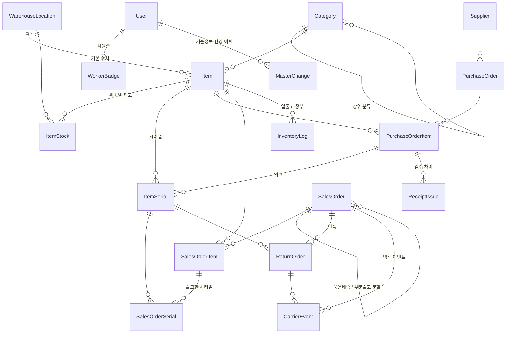
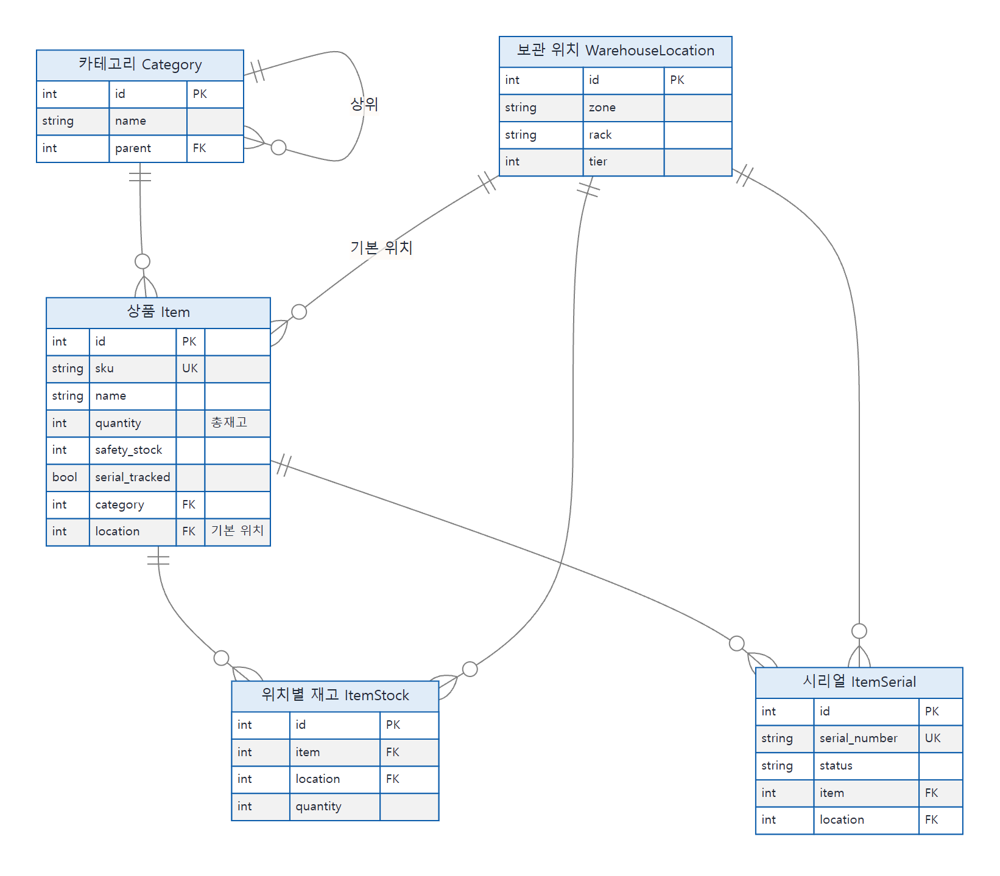
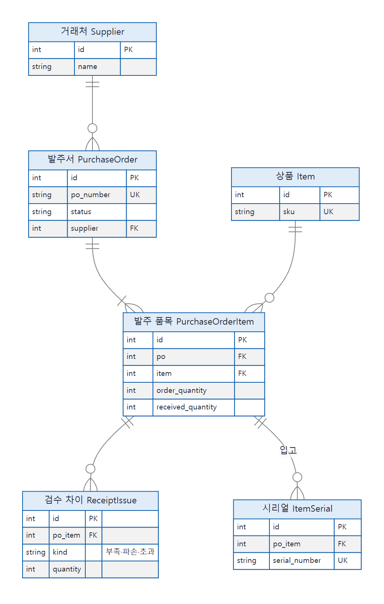
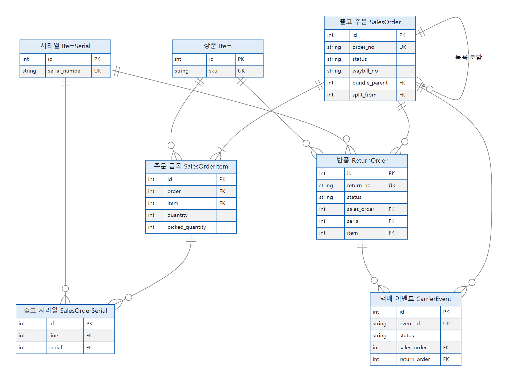
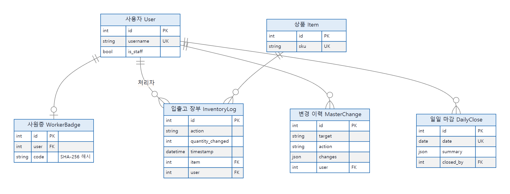

# 설계 문서

구조 지도는 [ARCHITECTURE.md](ARCHITECTURE.md), 사용법은 [README.md](../README.md)를 봅니다. 이 문서는 데이터 구조(ERD)와 주요 설계 결정을 정리합니다.

## 1. 데이터 구조 (ERD)

그 밖의 모델: `DailyClose`(일일 마감), `AppNotification`·`NotificationSeen`(화면 안 알림과 읽음 표시).

주요 컬럼을 포함한 영역별 ERD입니다. (정의는 [inventory/models.py](../inventory/models.py))

## 2. 주요 설계 결정

### 재고 수량은 한 곳에서만 바꾼다
총재고(`Item.quantity`)와 위치별 재고(`ItemStock`)가 어긋나면 현장에서 "화면에는 있는데 선반에 없는" 일이 생깁니다. 그래서 수량을 바꾸는 모든 경로(입고, 출고, 반품, 이동, 조정)가 [stock.py](../inventory/stock.py)의 `add`·`remove`·`move`를 거치게 했습니다. 위치별 합이 총재고를 넘지 않고, 모자라는 부분은 "위치 미지정" 재고로 보여줍니다.

### 동시 작업에서 재고가 틀어지지 않게
- 요청 하나를 하나의 트랜잭션으로 처리합니다(`ATOMIC_REQUESTS`). 오류가 나면 재고가 일부만 바뀌지 않습니다.
- 재고 행은 `select_for_update`로 잠그고, 수량은 `F()` 식으로 DB에서 직접 더하고 뺍니다. 두 작업자가 같은 상품을 동시에 옮겨도 수량 확인을 함께 통과하지 못합니다.
- 재고가 바뀐 기록은 모두 `InventoryLog`(입출고 장부)에 누가·언제·얼마나로 남깁니다.

### 시리얼 관리와 수량 관리를 한 흐름에서
상품마다 시리얼 관리 여부를 정합니다. 시리얼 상품은 1개씩 스캔하고 `ItemSerial`로 이력(입고→출고 주문→반품)을 추적하며, 그 외는 상품 코드 스캔이나 수량 입력으로 처리합니다. 시리얼 없이 들어와 있던 재고도 출고 때 시리얼을 붙여 점진적으로 전환할 수 있습니다.

### 관리 화면과 현장 화면을 분리
- 관리자(`is_staff`)는 주문·발주 등록, 기준정보, 보고서를 쓰는 관리 화면으로, 일반 계정은 스캔 중심의 큰 글씨 현장 화면(`/work`)으로만 들어갑니다. 권한은 화면 라우터와 API 양쪽에서 확인합니다.
- 현장 화면은 바코드 스캐너(키보드 입력)로 한 손 작업이 되도록 단축키·사원증 로그인·작업자 전환·F1 도움말을 넣었습니다.

### 택배사 연동은 한 파일로 격리
실제 택배사 대신 가상 택배사 서버(`mock_carrier/`)를 두고, WMS는 HTTP API와 서명된 웹훅으로만 통신합니다. 택배사를 바꿀 때는 [carrier.py](../inventory/carrier.py)만 교체하면 됩니다. 택배사 연속 장애는 감지해 알림을 보냅니다.

### 보안
- 사원증 코드는 DB에 해시로만 저장합니다(마이그레이션 0028).
- 로그인은 접속 주소별·계정별 횟수를 제한하고, 제한 기록은 파일 캐시에 남겨 서버 재시작 후에도 유지합니다.
- 화면에 CSP를 걸고, 운영 모드는 디버그를 끄며 요청 본문을 10MB로 제한합니다.
- 비밀 값은 `.env`로만 읽고 저장소에는 올리지 않습니다(`.env.example`만 포함).

### 운영 안정성
- 서버 로그는 일 단위로 회전 보관하고, 처리하지 못한 오류와 택배 장애는 웹훅(슬랙·디스코드)과 화면 안 알림으로 알립니다.
- `backup_db.py`로 보관 기간을 두고 백업하며, `restore_check.py`로 복원 리허설을 할 수 있습니다.
- 개발 서버는 pm2, 운영 모드는 빌드한 화면을 Django와 함께 waitress 서버 한 개로 제공합니다.

## 3. 품질 관리

| 구분 | 도구 | 실행 |
| --- | --- | --- |
| 백엔드 린트 | Ruff | `./verify.sh` |
| 백엔드 단위 테스트 | Django TestCase (170개) | `./verify.sh` |
| 화면 린트·빌드 | ESLint(경고 0), Vite | `./verify.sh` |
| 화면 자동 테스트 | Playwright 32개 (실제 서버·테스트 DB) | `cd wms-frontend && npm run e2e` |
| 커밋 시 검사 | pre-commit (ruff, eslint 등) | 자동 |
| CI | GitHub Actions | push·PR 시 자동 |
